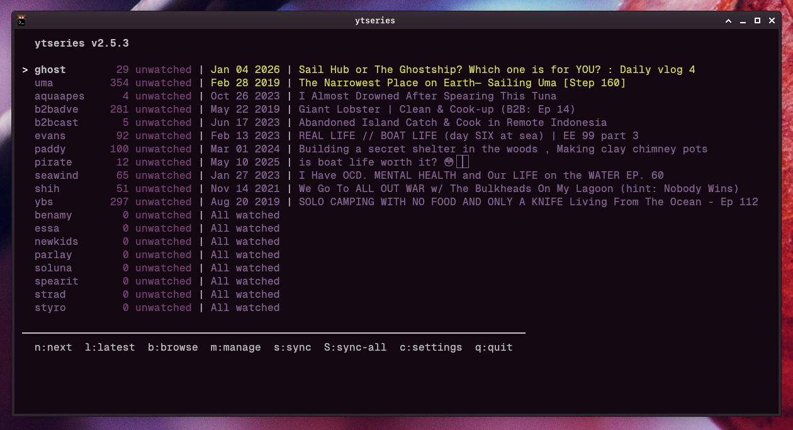
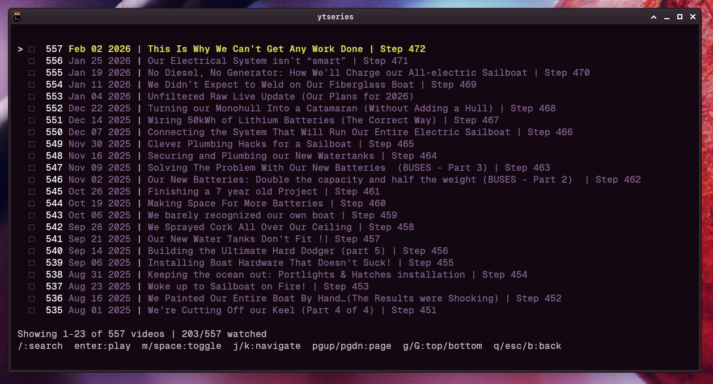
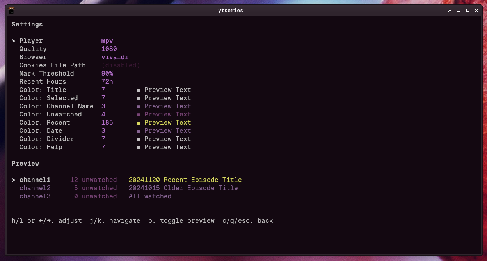

# ytseries v2.x.x

A fast, keyboard-driven TUI for watching YouTube playlists/channels chronologically with watch tracking.

## Features

- **Instant startup** - No online lookups at runtime (except playback)
- **Dual workflow support**:
  - Chronological watching (build series from start to finish)
  - Latest episode viewing (catch up on recent uploads)
- **Direct key bindings** - Navigate channels with j/k, press n/l/b to play/browse
- **Auto-mark at 90%** - mpv integration marks episodes watched at 90% threshold
- **Recent highlighting** - Channels with new episodes are highlighted (configurable, default 72h)
- **Background sync** - Cron-based updates keep cache fresh

## Screenshots


*Main view - channels sorted by recent activity, highlighted entries have new episodes*


*Browse mode - view and mark episodes for a channel*


*Settings - configure player, quality, colors, and more*

## Installation

```bash
make build
make install
```

This installs `ytseries` to `~/bin`.

## Dependencies

**Build:**
- Go 1.21+

**Runtime:**
- [yt-dlp](https://github.com/yt-dlp/yt-dlp) - Fetches video metadata and handles streaming
- [mpv](https://mpv.io/) - Video playback (VLC is supported but currently broken due to YouTube streaming issues)
- [Node.js](https://nodejs.org/) (or [Deno](https://deno.land/)) - JavaScript runtime required by yt-dlp

### Important: JavaScript Runtime Required

Recent yt-dlp versions require a JavaScript runtime (Node.js or Deno) for proper YouTube extraction. Without one, yt-dlp falls back to a degraded API path that provides throttled stream URLs, causing severe buffering during playback.

**ytseries v2.5.5+** passes `--js-runtimes=node` automatically and also skips HLS streams (preferring HTTPS/DASH) to avoid YouTube's aggressive HLS throttling. You should also install Node.js on your system:

```bash
# Arch/Manjaro
sudo pacman -S nodejs

# Ubuntu/Debian
sudo apt install nodejs

# macOS
brew install node
```

For a system-wide fix that benefits all yt-dlp usage, add to `~/.config/yt-dlp/config`:

```
--js-runtimes=node
```

## Quick Start

### First Run

If you have existing ytseries v1 config, it will be automatically detected.

Otherwise, add channels first. The current version supports:
- Press `a` in the TUI.
- Or manually edit `~/.config/ytseries/aliases.tsv`:
  ```
  benamy	https://www.youtube.com/@sailwithbenandamy/videos
  ```

Then press `s` or `S` in the TUI to sync, or run `ytseries -s` from the command line.
This can take a moment especially on larger channels, I suggest using sync via cron.

  0 */3 * * * /home/username/bin/ytseries -sync >/dev/null 2>&1

### Daily Usage

```bash
# Launch TUI
ytseries

# Navigate channels: j/k or arrow keys
# Press action keys:
#   n or Enter - Play next unwatched episode (chronological)
#   l          - Play latest video (most recent upload)
#   s          - Sync current channel
#   S          - Sync all channels
#   q          - Quit
```

### Background Sync

Add to crontab to sync every 2 hours:

```bash
   0 */2 * * * /home/USERNAME/bin/ytseries -sync >/dev/null 2>&1
```

## Configuration

Edit `~/.config/ytseries/config`:

```
player=mpv
ytdl_format=best[height<=1080]
mark_threshold=90
recent_hours=72
```

### Recent Highlighting

After syncing, channels with newly uploaded episodes are highlighted in the TUI. This makes it easy to spot which channels have fresh content. The highlight persists for 72 hours by default, configurable via `recent_hours` in the config file.

## Key Bindings

### Main View

| Key | Action |
|-----|--------|
| `j`/`↓` | Move down |
| `k`/`↑` | Move up |
| `g` | Go to top |
| `G` | Go to bottom |
| `n`/`Enter` | Play next unwatched |
| `l` | Play latest video |
| `b` | Browse episodes |
| `m` | Manage channels |
| `s` | Sync channel |
| `S` | Sync all |
| `c` | Settings |
| `q` | Quit |

### Browse Mode (`b`)

| Key | Action |
|-----|--------|
| `j`/`k` | Navigate episodes |
| `g`/`G` | Jump to top/bottom |
| `PgUp`/`PgDn` | Page up/down |
| `Enter` | Play selected video |
| `m`/`Space` | Toggle watched |
| `/` | Search |
| `q`/`Esc`/`b` | Exit browse |

### Manage Mode (`m`)

| Key | Action |
|-----|--------|
| `a` | Add channel |
| `d` | Delete channel |
| `j`/`k` | Navigate |
| `q`/`Esc`/`m` | Exit manage |

## Cache Structure

```
~/.config/ytseries/
  ├── aliases.tsv    # name<TAB>url
  ├── keys.tsv       # url<TAB>channel_key
  ├── config         # key=value settings
  └── history.tsv    # watch history

~/.local/state/ytseries/<channel_key>/
  ├── videos.tsv     # All videos (chronologically sorted)
  ├── watched.txt    # Watched video IDs
  ├── dates.tsv      # Upload dates cache
  └── recent.tsv     # Recent videos cache
```

## Architecture

- **Go + Bubble Tea** - Fast TUI framework
- **TSV cache files** - Simple, fast, awk-compatible
- **External tools** - yt-dlp (sync), mpv/vlc (playback)
- **Lua auto-mark** - mpv script for watch percentage tracking

## License

MIT License - see [LICENSE](LICENSE) for details.

## Disclaimer

This is a personal-use tool that provides a terminal interface for managing YouTube channel subscriptions. It acts as a wrapper around [yt-dlp](https://github.com/yt-dlp/yt-dlp) and [mpv](https://mpv.io/), which handle all interaction with YouTube.

- No video content is downloaded, stored, or redistributed
- Videos are streamed directly through mpv/yt-dlp
- Users are responsible for compliance with YouTube's Terms of Service
- This project is not affiliated with or endorsed by YouTube/Google
